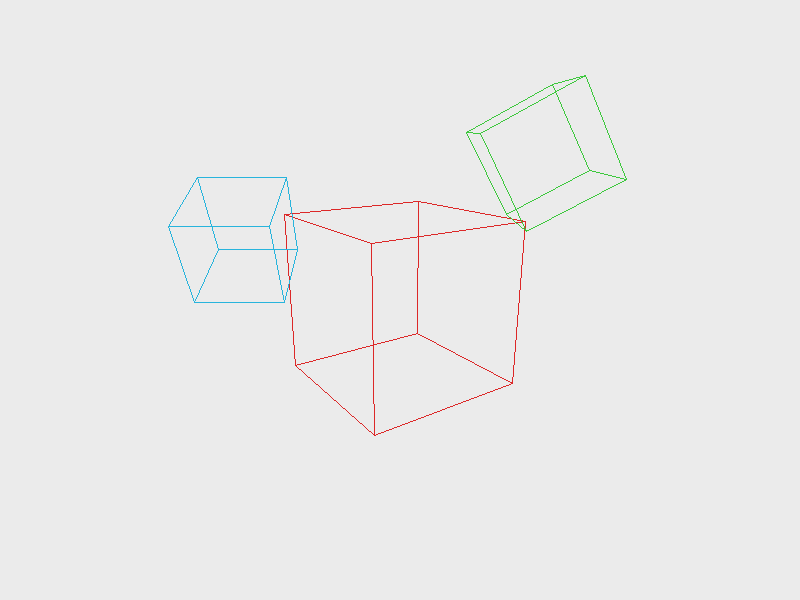

# 3D Transform Pipeline Renderer — 三维变换管线渲染器

## 编译运行
```bash
g++ main.cpp -o output -std=c++17 -O2 -Wall -Wextra
./output
```

## 输出结果
```
== Quantitative Pipeline Verification ==
  [PASS] Translation offset exact (3,-1,4)
  [PASS] Scale (2,3,4) exact
  [PASS] RotationY(90deg) maps +X -> -Z (right-hand rule)
  [PASS] Rotation preserves vector length (isometry)
  [PASS] LookAt maps target origin to view z = -distance (-5)
  [PASS] LookAt preserves right axis orientation
  [PASS] Perspective maps znear (z=-1) to NDC z=-1
  [PASS] Perspective maps zfar (z=-100) to NDC z=+1
  [PASS] fov=90 => near-plane corner projects to NDC (1,1)
  [PASS] Perspective foreshortening: farther object projects smaller
  [PASS] MVP: all points within NDC range [-1,1]
  [PASS] MVP: nearer point yields smaller NDC z (near=-1)
  => 0 failures

== Render quantitative checks ==
  [PASS] Framebuffer contains rendered edges (non-background pixels)
  [PASS] Substantial geometry rendered (>1000 edge pixels)
  colored pixels = 3222
  [PASS] Framebuffer type-safety guarantee (unsigned char [0,255])

Total failures: 0
ALL CHECKS PASSED
```

## 输出结果图


## 技术要点
- **齐次坐标 (Vec4/Mat4)**：用 4×4 列主序矩阵统一表示平移、旋转、缩放，点用 `w=1`、方向向量用 `w=0` 区分，`applyPoint` 自动执行透视除法。
- **LookAt 相机**：右手坐标系，`z = normalize(eye - target)`（相机看向 -z），`x = up × z`、`y = z × x` 构造正交基，平移分量用 `-dot(axis, eye)` 消除相机位移。
- **透视投影**：`f = 1/tan(fov/2)`，将 `znear/zfar` 映射到 NDC 的 `z ∈ [-1, 1]`，`m[11] = -1` 使 `w = -z_view` 完成透视除法。
- **MVP 合成**：`MVP = P * V * M` 一次矩阵乘法完成模型→视图→投影，逐顶点变换后用 NDC 裁剪（`z∈[-1,1]`、屏幕边界 +20% 余量）。
- **Bresenham 直线光栅化**：wireframe 立方体边缘绘制，NDC `+y` 向上翻转成屏幕 `+y` 向下。

## 量化验证（非视觉检查）
1. **平移/缩放精确性**：`translation(3,-1,4)`、`scale(2,3,4)` 对 `(1,1,1)` 点的作用结果与手算一致（误差 < 1e-6）。
2. **旋转等距性**：`rotationY(90°)` 将 `+X` 映射到 `-Z`（右手定则），且变换后向量长度不变（等距变换）。
3. **LookAt 正确性**：相机置于 `(0,0,5)` 看向原点时，原点映射到视图空间 `z = -distance = -5`，右轴方向保持 `+X`。
4. **透视投影深度映射**：`znear(z=-1)` → NDC `z=-1`，`zfar(z=-100)` → NDC `z=+1`，`fov=90°` 近平面角点精确投影到 NDC `(1,1)`。
5. **透视缩短现象**：同方向远近两点，远点投影屏幕尺寸更小（`|NDC.x_far| < |NDC.x_near|`）。
6. **MVP 深度顺序**：组合变换后所有点在 NDC `[-1,1]` 内，且近点 NDC z 更小（`near=-1`）。
7. **渲染完整性**：帧缓冲包含 3222 个非背景像素（>1000），确认线框几何体实际被光栅化。
