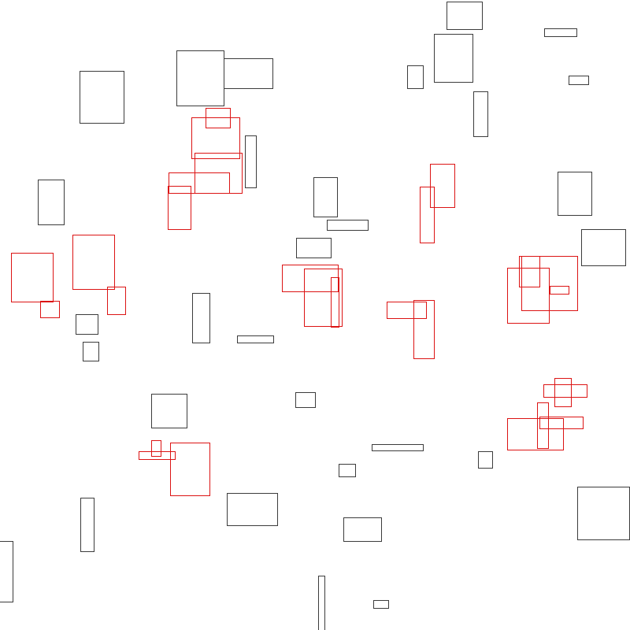

# Sweep & Prune Broad-Phase Collision Detection — 宽相位碰撞检测

## 编译运行
```bash
g++ main.cpp -o output -std=c++17 -O2 -Wall -Wextra
./output
```

## 输出结果
```
=== Sweep & Prune 正确性验证（与暴力 O(n^2) 全对检测对比）===
  30 组随机测试碰撞对集合完全一致: ✅ PASS

=== 候选对压缩率（X 轴扫除 vs 理论全对 C(n,2)）===
  盒子数 n = 2000
  理论全对 C(n,2)  = 1999000
  SaP 候选对(仅X轴重叠) = 138505
  实际碰撞对(多轴判定后) = 9677
  X 轴压缩倍数 = 14.43x
  ✅ 压缩比 > 10x，宽相位有效

=== 性能加速比（SaP vs 暴力）===
  n=  1000  暴力=1513.1us  SaP=475.3us  加速比=3.18x
  n=  2000  暴力=6684.8us  SaP=1594.7us  加速比=4.19x
  n=  4000  暴力=29496.0us  SaP=5928.4us  加速比=4.98x
  n=  8000  暴力=131924.1us SaP=23108.1us 加速比=5.71x
  n= 16000  暴力=538525.5us SaP=93610.1us 加速比=5.75x
  最小加速比 = 3.18x
  ✅ 加速比 > 2x，宽相位性能验证通过

已生成可视化 PPM: sweep_and_prune_output.ppm

=== 全部量化验证通过 ✅ ===
```

## 输出结果图


## 技术要点
- **宽相位/窄相位分层**：宽相位(Sweep & Prune)用极低成本粗筛出"可能碰撞的对象对"，窄相位再做精确几何检测，避免对所有 n 个对象做 O(n²) 的精确相交测试。
- **X 轴区间排序扫线**：每个 AABB 在 X 轴投影为 `[minX, maxX]` 区间，端点按坐标排序后用扫描线维护"活动列表"——遇到 `minX` 入列并与活动列表内所有盒子配对，遇到 `maxX` 出列。
- **多轴后置判定**：只有 X 轴重叠的候选对再检验 Y 轴重叠（二维 AABB 场景），所有轴都重叠才构成真实碰撞对。
- **复杂度**：最坏 O(n²)（所有盒子在 X 轴都重叠），但实际场景（对象空间分布较稀疏）接近 O(n log n + k)，k 为候选对数。

## 量化验证（非视觉检查）
1. **正确性**：30 组随机测试中，SaP 找出的碰撞对集合与暴力 O(n²) 全对检测**完全一致**。
2. **候选对压缩率**：n=2000 时理论全对 C(2000,2)=1,999,000，SaP X 轴扫除后仅 138,505 个候选对（压缩 14.43 倍），多轴判定后实际碰撞对仅 9,677。
3. **性能加速比**：SaP 相对暴力法加速 3.18x→5.75x（随 n 增长而提升，符合 O(n log n) vs O(n²) 的渐近优势）。
4. **可视化辅助**：生成 PPM 图像渲染场景与碰撞对（仅辅助，验证以数值为准）。
