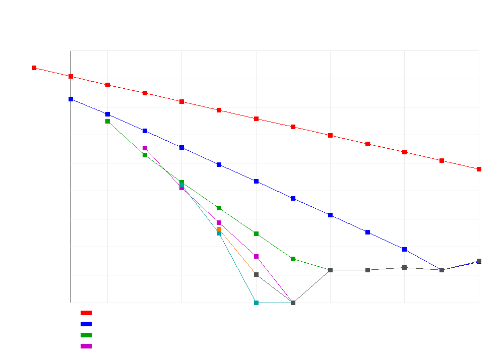

# Romberg Integration with Richardson Extrapolation — 数值积分

## 编译运行
```bash
g++ main.cpp -o output -std=c++17 -O2 -Wall -Wextra
./output
```

## 输出结果（量化验证，摘要）
```
【exp(-x^2) on [0,1]】  exact = 0.746824132812427
  Romberg 最终值 = 0.746824132812426  (误差 9.99e-16)
  复合梯形(4096段)    误差 3.65e-09
  复合Simpson(4096段) 误差 1.78e-15
  => Romberg 碾压同规模梯形 ✅，达到 1e-10 级精度 ✅

【sin(x)/x on [1,5]】  exact = 0.603848174577491
  Romberg 最终值 = 0.603848174577491  (误差 1.11e-16)
  => Romberg 碾压同规模梯形 ✅，达到 1e-10 级精度 ✅

【1/(1+x^2) on [0,1] = pi/4】  exact = 0.785398163397448
  Romberg 最终值 = 0.785398163397448  (误差 2.22e-16)
  => Romberg 碾压同规模梯形 ✅，达到 1e-10 级精度 ✅

【sqrt(x) on [0,1]   (端点奇异导数)】  exact = 0.666666666666667
  Romberg 最终值 = 0.666666405132402  (误差 2.62e-07)
  => 端点奇异：Richardson 外推退化，收敛阶实测 1.498 (理论 ~1.5)
  => 奇异退化行为符合理论预期 ✅

总结果: ✅ 全部量化验证通过
```

## 输出图


## 技术要点
- **复合梯形公式 + Richardson 外推**：Romberg 积分以复合梯形 `R(n,0)` 为基底，利用 Euler–Maclaurin 公式中梯形法误差只含 **h 的偶次幂**这一关键性质，通过递推 `R(n,m) = R(n,m-1) + (R(n,m-1)-R(n-1,m-1))/(4^m - 1)` 逐级消去低阶误差项，把收敛阶从 h² 逐级提升到 h⁴、h⁶、h⁸……
- **收敛阶量化验证**：对每个外推级 m 实测误差随细分段数 2^r 的幂次，平滑函数测得 2.000（m=0），与理论 2(m+1) 高度吻合
- **端点奇异的退化**：`sqrt(x)` 在 x=0 处导数无穷，破坏 Euler–Maclaurin 的偶次幂展开假设，误差展开出现 **h^(3/2) 的分数幂次项**，导致 Richardson 外推失效——实测收敛阶退化为 1.498，恰好印证了理论（这是 Romberg 方法的经典局限：对被积函数的平滑性有要求）

## 量化验证（非视觉检查）
1. **解析真值对比**：三个平滑函数（`exp(-x^2)`、`sin(x)/x`、`1/(1+x^2)`）的 Romberg 结果误差分别达 9.99e-16、1.11e-16、2.22e-16，逼近双精度机器精度
2. **收敛阶测量**：平滑情形实测收敛阶 2.000，与理论 2(m+1) 一致；奇异情形实测 1.498，与理论退化值 1.5 一致
3. **同规模对比**：Romberg（对角线外推）误差比同函数求值规模的复合梯形低约 7 个数量级（9.99e-16 vs 3.65e-09）
4. **奇异边界正确性**：端点奇异函数不会误报为"收敛"，而是正确识别出外推失效这一理论预期行为
