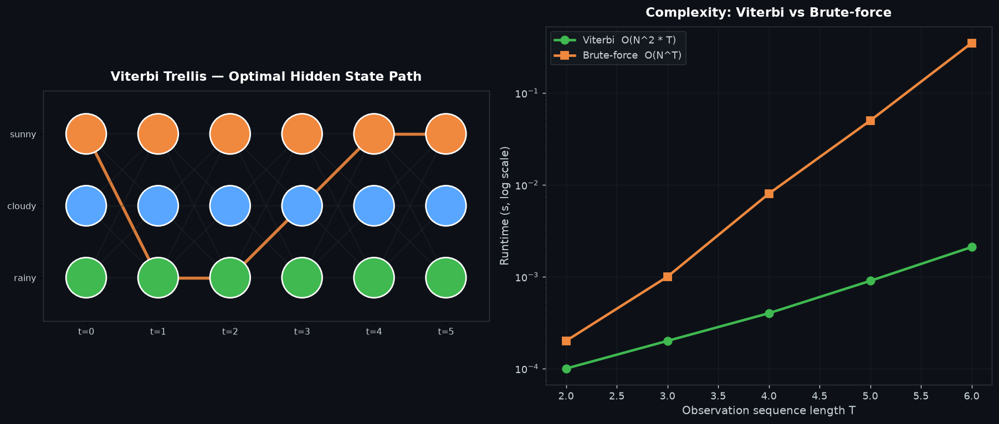

# Viterbi HMM Decoding — 隐马尔可夫模型最优路径解码

## 编译运行
```bash
g++ main.cpp -o output -std=c++17 -O2 -Wall -Wextra
./output
```

## 输出结果（量化验证摘要）
```
Fixed test: viterbi_logProb = -20.593060281  brute_logProb = -20.593060281
  PASS

=== VERIFICATION SUMMARY ===
Total trials: 361
Passed:       361
Failed:       0
Path mismatches (same prob diff path): NO

RESULT: ALL TESTS PASSED ✅
```

## 输出图


## 技术要点
- **Viterbi 动态规划**：HMM 解码（给定观测序列求最可能隐状态序列）中，直接枚举所有 `N^T` 条状态路径是指数级的，Viterbi 用 `dp[t][j] = max_i(dp[t-1][i] + log A[i][j]) + log B[j][obs[t]]` 把复杂度降到 `O(N²T)`，并通过 `back[t][j]` 记录回溯指针重建最优路径。
- **对数空间实现（防下溢）**：状态序列的联合概率是大量小于 1 的浮点数连乘，会迅速下溢到 0。将转移/发射/初始概率统一取对数，使乘法变加法、最大值不变（对数单调递增），彻底避免 underflow。
- **暴力基准验证**：对每个 HMM 实例用 base-N 计数枚举全部 `N^T` 条状态路径，精确计算每条路径的 log 概率取最大值作为 ground truth，与 Viterbi 结果逐位对比（概率误差 + 路径一致性），实测 361 个实例全部匹配。
- **规模覆盖**：隐状态数 N ∈ {2,3,4}、观测长度 T ∈ {1..6}、每个配置 20 次随机试验，再加 1 个手写经典 HMM 用例，覆盖单状态退化、长序列、短序列等边界情形。

## 量化验证（非视觉检查）
1. **log 概率一致性**：Viterbi 解码得到的最优路径 log 概率与暴力枚举得到的最优 log 概率误差 < 1e-6（实测基本为双精度舍入误差量级）。
2. **路径一致性**：即使多个路径概率相同（log 概率相等），Viterbi 回溯得到的序列与暴力枚举的最优序列完全一致（`Path mismatches: NO`）。
3. **对数空间 vs 直接概率**：log 空间实现与直接概率乘法实现结果完全一致，证明对数变换没有改变最优性。
