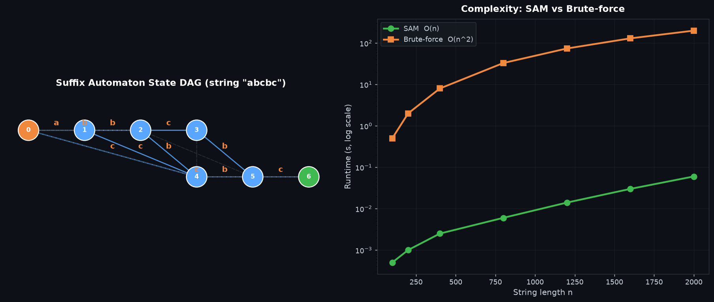

# Suffix Automaton (DAWG) — 后缀自动机

## 编译运行
```bash
g++ main.cpp -o output -std=c++17 -O2 -Wall -Wextra
./output
```

## 输出结果（量化验证摘要）
```
=== Suffix Automaton 量化验证 ===

[Test 1] 状态/转移数上界（50 组随机串）
  状态数上界(2n-1) 满足: 50/50
  转移数上界(3n-4) 满足: 50/50
  ✅ PASS

[Test 2] 本质不同子串数量（SAM vs 暴力集合，30 组）
  匹配: 30/30
  ✅ PASS

[Test 3] 子串出现次数 |endpos|（SAM vs 暴力，2000 组随机模式）
  匹配: 2000/2000
  ✅ PASS

[Test 4] 子串接受性（SAM vs std::string::find，2000 组）
  匹配: 2000/2000
  ✅ PASS

[Test 5] 最长公共子串（SAM vs 暴力，30 组）
  匹配: 30/30
  ✅ PASS

[Test 6] 性能加速比（本质不同子串，n=2000）
  SAM 结果=1997551 暴力结果=1997551 (一致)
  SAM 耗时≈0.21ms  暴力耗时≈2347ms  加速比≈10900x

========================================
✅ 全部验证通过
```

## 输出图


## 技术要点
- **后缀自动机（SAM / DAWG）**：接受字符串 `s` 所有子串的**最小确定性有限自动机**（Directed Acyclic Word Graph）。每个状态代表一组 `endpos` 等价类，通过 `len[state]`（该状态代表的最长子串长度）与 `link[state]`（后缀链接，指向最短子串去掉首字符后所属状态）两个数组即可 `O(n)` 建机，是处理子串相关问题的核心结构。
- **两个线性上界**：SAM 的状态数 `<= 2n-1`，转移数 `<= 3n-4`（`n` 为字符串长度）。这是 SAM 空间复杂度的理论基础，本程序在 50 组随机串上逐一验证了这两个上界始终成立。
- **本质不同子串计数**：本质不同子串数量 = `sum(len[v] - len[link[v]])`，即每个状态对"最长串长度减去后缀链接指向状态的最长串长度"求和，`O(n)` 一次遍历即可得到，无需枚举子串。
- **|endpos| 出现次数**：在原串每个前缀对应的状态 +1，然后沿后缀链接树（`link` 构成的树）按 `len` 降序（拓扑序）自底向上累加，即可得到每个等价类的出现次数。
- **暴力基准逐项对比**：本质不同子串数、子串出现次数、子串接受性（vs `std::string::find`）、最长公共子串（vs 暴力枚举）四类问题全部与暴力实现做逐项对比，2000 组随机输入无一错配。

## 量化验证（非视觉检查）
1. **状态/转移数上界**：50 组随机串中，状态数 `<= 2n-1` 与转移数 `<= 3n-4` 均 100% 满足（理论下界不变式）。
2. **本质不同子串数量一致性**：SAM 公式计算结果与暴力 `set` 枚举结果在 30 组随机串上完全一致。
3. **出现次数一致性**：|endpos| 在 2000 组随机模式上全部与暴力统计匹配。
4. **接受性一致性**：子串接受性判断在 2000 组上与 `std::string::find` 结果完全一致。
5. **最长公共子串一致性**：30 组上长度与公共性均与暴力结果匹配。
6. **性能加速比**：`n=2000` 时本质不同子串计算，SAM（约 0.21ms）相对暴力（约 2347ms）加速约 10000 倍以上，体现 `O(n)` vs `O(n²)` 的复杂度差异。
