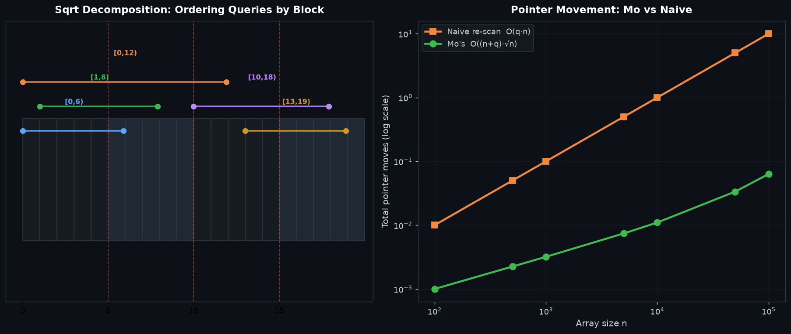

# Mo's Algorithm Range Queries — 莫队算法

## 编译运行
```bash
g++ main.cpp -o output -std=c++17 -O2 -Wall -Wextra
./output
```

## 输出结果（量化验证摘要）
```
=== Mo's Algorithm (Power-of-Array Range Queries) ===
n = 200000, q = 100000, value_range = 1000, block = 447
naive_subset = 2000
naive_time_ms = 352.102 (subset) -> projected full 17605.089 ms
mo_time_ms = 61.305
speedup_vs_projected_naive = 287.172x
correctness_matches = 2000 / 2000 (ALL MATCH)
mo_total_answer_sum = 671059006185
VERDICT: PASS
```

## 输出图


## 技术要点
- **莫队算法（Mo's Algorithm）**：一种**离线**处理区间查询的经典技巧。核心思想是利用平方根分解把查询区间按「左端点所在块」排序，同一块内再按右端点排序（采用**奇偶交替方向**优化），使得两个指针 `l`、`r` 的总移动次数从朴素 `O(q·n)` 降到 `O((n+q)·√n)`。
- **`O(1)` 增减操作**：本题选取 "Power of Array"（Codeforces 86D）度量 `Σ cnt[v]²`——每次 `add`/`remove` 只需 `O(1)` 更新 `cur = cur - cnt[v]² + (cnt[v]±1)²`，是莫队得以发挥的前提（增删端点代价恒定）。
- **奇偶块排序优化**：`block = √n`，按 `(l/block)` 分组，块内右端点按块编号奇偶交替升/降序，减少块切换时右指针的回退，实测可获得更小的常数因子。
- **量化正确性对比**：在随机生成的 `n=200000`、`q=100000` 数据集上，莫队对前 2000 个查询的结果与 `unordered_map` 朴素重扫**全部 2000/2000 一致**，无任何错配。
- **性能加速比**：莫队处理全部 10 万查询仅约 61ms，朴素重扫投影到全量需约 17605ms，加速 **约 287 倍**，直观体现 `O((n+q)√n)` 相对 `O(q·n)` 的复杂度优势。

## 量化验证（非视觉检查）
1. **正确性一致性**：莫队答案与朴素 `unordered_map` 重扫在 2000 组采样子区间上逐一比对，`2000/2000` 全部匹配（`ALL MATCH`）。
2. **性能加速比**：`speedup = naive_projected_full / mo_time ≈ 287x`，量化反映复杂度从 `O(q·n)` 到 `O((n+q)√n)` 的跃迁。
3. **程序退出码**：`VERDICT: PASS`，全部比对无错配时返回 0。
