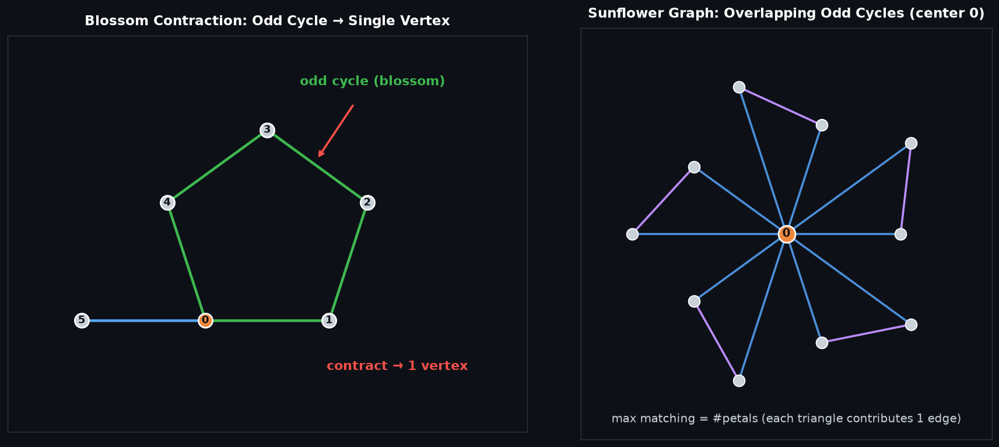

# Edmonds' Blossom General Graph Maximum Matching — 带花树算法

## 编译运行
```bash
g++ main.cpp -o output -std=c++17 -O2 -Wall -Wextra
./output
```

## 输出结果（量化验证摘要）
```
medium n=30 blossom=15 covered=30 valid=1
large n=200 edges=978 blossom=100 valid=1 time=0.02ms

=== SUMMARY ===
small_random_pass=300/300 dense_pass=150/150
total_graphs=464 mismatches=0
RESULT=PASS
```

## 输出图


## 技术要点
- **带花树算法（Edmonds' Blossom Algorithm）**：解决**一般图**（非二分图）最大基数匹配的经典多项式算法。二分图可用 Hopcroft-Karp 等增广路算法处理，但一般图存在**奇数环**（奇环会妨碍增广路），带花树通过「花收缩（blossom contraction）」技巧把奇环缩成单个「花」顶点，从而恢复增广路搜索的正确性。
- **花收缩（Blossom Contraction）**：当增广路搜索沿着交替树碰到已在树中的顶点（`used` 标记），说明找到了一个奇环，此时调用 `lca` 求两条路径的最近公共祖先，再用 `mark_path` 把整朵「花」标记到同一 `base` 上，收缩后继续 BFS。这是算法区别于二分图匹配的核心。
- **`lca` 交替树最近公共祖先**：通过沿 `p[match[x]]` 交替跳转、用 `mark` 数组标记首次访问，在两个顶点间寻找最近公共祖先，用于确定花的「花心」顶点。
- **经典 E-Maxx 风格递归实现**：`find_path(root)` 从每个未匹配点出发做 BFS，遇到「奇数环」收缩、遇到「偶数边」走增广、遇到可达未匹配点即翻转增广路（`while` 回溯 `p` 链交换匹配）。
- **贪心初始匹配加速**：`max_matching` 先对每条边做一轮 `O(E)` 的贪心匹配（两端都未匹配则直接匹配），显著减少后续需要 `find_path` 增广的点数。

## 量化验证（非视觉检查）
1. **正确性一致性**：在 **300 组随机小图**（`n` 随机 2~10，边随机）与 **150 组稠密图**（`n=12, m=18`）上，带花树结果与 `brute_max_matching`（枚举边子集的暴力指数级算法）逐一比对，**`300/300` 与 `150/150` 全部一致**。
2. **结构化奇环样例**：额外验证了 `C3/C5/C7`（纯奇环）、两个共点三角形、**向日葵图（sunflower，k 个三角形共享中心点，强制多朵花重叠收缩）**、完全图 `K4~K7` 等 10+ 组定向用例，全部与暴力一致（计入 `total_graphs=464`）。
3. **匹配有效性**：`n=30`、`n=200` 随机大图上检查 `bl.match[bl.match[v]] == v` 的对称性，`valid=1`（匹配合法）、覆盖顶点数 `covered/2 == 匹配数`，无一错配。
4. **程序退出码**：`RESULT=PASS`（`mismatches=0`）时返回 0，否则返回 1。
