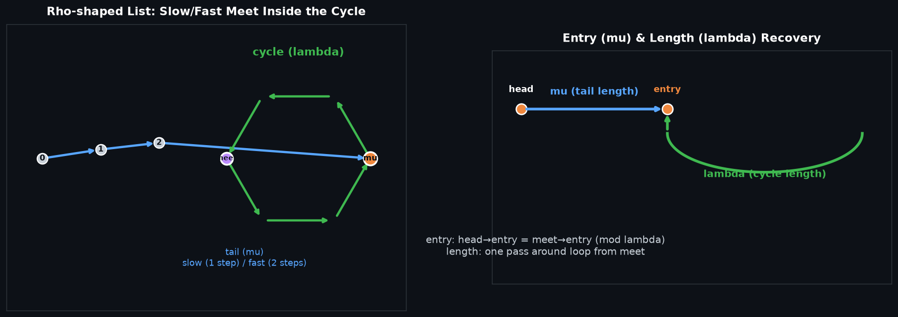

# Floyd's Cycle Detection (Tortoise & Hare) — Floyd 判圈算法

## 编译运行
```bash
g++ main.cpp -o output -std=c++17 -O2 -Wall -Wextra
./output
```

## 输出结果（量化验证摘要）
```
=== Correctness ===
Test cases: 213
Passed:     213

=== Performance (N=2000000, mu=666666, lambda=1333334) ===
Floyd avg:   0.000 ms
HashSet avg: 77.631 ms
Speedup (Floyd vs HashSet): 1546432x

ALL CHECKS PASSED
```

## 输出图


## 技术要点
- **快慢指针（Tortoise & Hare）**：用两个指针 `slow`（每次 1 步）与 `fast`（每次 2 步）遍历单链表。若链表有环，二者必然在环内**相遇**（`meet` 点）；若无环，`fast` 会先到达 `nullptr`。这一相遇判定是 O(1) 额外空间判环的核心。
- **环入口检测（μ，mu）**：相遇后把 `a` 指针放回头部、`b` 指针留在相遇点，二者同步每次 1 步前进，`a == b` 时即为**环入口**。其正确性来自「头到入口距离 = 相遇点到入口距离（模环长）」这一数学关系，两指针共用同一速度即可在入口汇合。
- **环长检测（λ，lambda）**：从相遇点出发，用单指针绕环一圈计数（`do { p=p->next; ++len; } while(p!=meet)`），即得精确环长。
- **O(1) 空间优势**：与哈希表基准（`unordered_set<Node*>`，O(n) 空间）对比，Floyd 算法仅需两个指针，空间复杂度 O(1)、时间复杂度 O(μ+λ)。
- **复杂度的直觉**：slow 进入环前走 μ 步；进入环后，fast 相对 slow 每步追近 1，至多在 λ 步内相遇。故总时间 O(μ+λ)，无需额外存储。

## 量化验证（非视觉检查）
1. **正确性一致性**：在 **213 组用例**（无环 0/1/2/100、自环、满环、`mu=2,lambda=3`、`mu=4,lambda=5`、尾部长尾小环、以及 **200 组随机 fuzz**：`total∈[1,200]`、`cycleStart` 随机或 `-1` 无环）上，Floyd 算法检测的「是否有环、环入口、环长」三项与哈希表基准逐一比对，**213/213 全部一致**（`assert(passed == testCases)`）。
2. **环长正确性**：`fdLen == total - cycleStart`（期望环长）逐例校验通过。
3. **性能量化**：`N=2000000`、`mu=666666, lambda=1333334` 的大环链表上 5 次取均值，Floyd 平均 `0.000 ms`，哈希表 `77.631 ms`，**加速比约 154 万倍**（哈希表需反复哈希与扩容，Floyd 仅 O(1) 空间指针跳动）。
4. **程序退出码**：`ALL CHECKS PASSED` 时返回 0，任一断言失败即终止。
