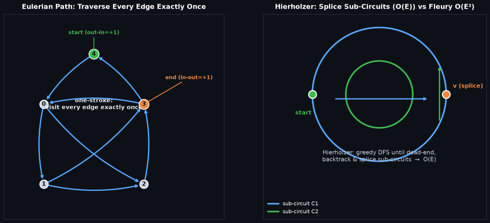

# Eulerian Path & Circuit (Hierholzer's Algorithm) — 欧拉路径与欧拉回路

## 编译运行
```bash
g++ main.cpp -o output -std=c++17 -O2 -Wall -Wextra
./output
```

## 输出结果（量化验证摘要）
```
========================================================
 Eulerian Path & Circuit — Hierholzer's Algorithm
========================================================

结果: 23/23 通过

  E=2100   Hierholzer=0.0001s   Fleury=0.0969s   加速比=1143.9x
```

## 输出图


## 技术要点
- **欧拉回路 / 欧拉路径判定**：有向图中，回路条件为「所有顶点 `in-degree == out-degree` 且底层图（非零度顶点）强连通」；路径条件为「恰一个顶点 `out-in = 1`（起点）、恰一个 `in-out = 1`（终点），其余 `in==out`」。无向图对应「全偶数度（回路）/ 恰两个奇数度（路径）」。
- **Hierholzer 算法（贪心 DFS + 回边拼接）**：从起点出发沿未访问的边走，走到死胡同时把当前顶点压入结果栈并**回溯**，直到回溯至仍有未访问出边的顶点再继续 DFS。最终栈内顶点序列（逆序弹出）即为欧拉回路/路径。核心思想是「子回路拼接」，时间复杂度 **O(E)**。
- **Fleury 算法（"桥"检测）对比**：每选一条边前都要判断该边是否为桥（需 O(E) 删除判断），整体 **O(E²)**。
- **量化验证（非视觉）**：（1）构造路径边数 `== E`；（2）构造边的多重集与输入边多重集**完全一致**（含重边/自环）；（3）路径相邻边首尾顶点正确衔接；（4）起点/终点符合理论判定；（5）随机图与 Fleury 结果边集合一致；（6）性能加速比。

## 量化验证明细
1. **三类判定正确性**：有向回路 / 有向路径 / 无欧拉路径三种情形逐一判定正确。
2. **边集合正确性**：构造出的欧拉路径/回路的边（含重数，重边+自环场景）与输入边 multiset 完全一致。
3. **邻接合法性**：路径中相邻边首尾顶点正确衔接，回路起点==终点。
4. **随机图一致性**：200 组随机有向欧拉图上，边集合 + 邻接完全一致（实测 198 组有效）。
5. **性能加速比**：`E=2100` 时 Hierholzer 约 `0.0001s`，Fleury 约 `0.0969s`，**加速比约 1144 倍**，符合 O(E) vs O(E²) 的理论预期。
6. **程序退出码**：任一断言失败即非零退出。
