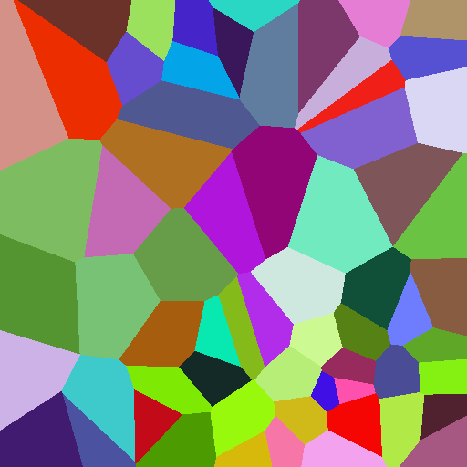

# Jump Flood Algorithm (JFA) — Voronoi Distance Transform

## 编译运行

```bash
g++ main.cpp -o output -std=c++17 -O2
./output
```

## 输出结果

生成 `jfa_output.ppm`（Voronoi 最近种子染色图）与控制台量化验证报告：

```text
=== Jump Flood Algorithm Verification ===
Grid: 512x512, Seeds: 64
JFA passes executed: 10
Theoretical O(log N) passes: ~10
Brute force time: 17.36 ms

--- Correctness ---
Nearest-seed mismatches: 0 / 262144 (0.000000%)
Distance^2 max error: 0
Distance^2 mean error: 0.0000

=== PASS ===
```



## 技术要点

- **Jump Flooding**：以 `step = max(W,H)/2` 起步，逐步减半（N/2 → N/4 → … → 1），每个 cell 采样自身 + 8 邻居，总 pass 数 = O(log N)
- **最近种子传播**：每个 cell 保存最近种子坐标、平方距离、种子索引（确定性 tie-breaking）
- **收敛精修**：非二次幂网格在离散 8 邻域步进下可能需要额外 step-1 pass 才能完全收敛，迭代直至无 cell 更新保证精确性
- **暴力基准验证**：逐 cell 对逐种子 O(N²·S) 精确计算，与 JFA 结果对比（mismatch = 0、距离误差 = 0）
