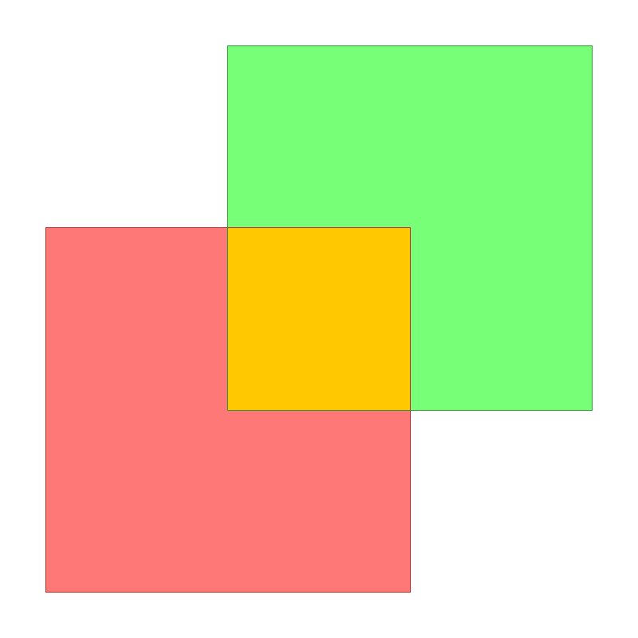

# Polygon Boolean Operations (Union / Intersection / Difference)

## 编译运行

```bash
g++ main.cpp -o output -std=c++17 -O2
./output
```

## 输出结果

生成 `polygon_boolean_output.png`（两多边形 A/B 与布尔结果区域的栅格可视化）与控制台量化验证报告：

```text
areaA=16.000000  areaB=16.000000
A_union_B              = 28.000000  (expected 28.000000)  PASS
A_intersect_B          = 4.000000  (expected 4.000000)  PASS
A_minus_B              = 12.000000  (expected 12.000000)  PASS

===== Extended Test Suite =====
disjoint / contain / diamond / tri / concave / rot 全部 PASS

=== ALL TEST SUITES PASSED ===
```



## 技术要点

- **水平扫描线 + 精确解析积分**：沿 y 轴扫描，临界 y 取所有顶点 y 坐标与两多边形边交点的 y 坐标。在每个 y-slab 内，多边形覆盖区间长度 L(y) 是分段线性函数，梯形法则（区间内部极限采样）得到**精确**结果，无采样误差。
- **布尔运算语义**：在每个 y 高度求两多边形覆盖区间 [l,r] 的并/交/差，通过 shoelace 面积公式对并 (union)、交 (intersection)、差 (difference) 分别积分求和得出精确面积。
- **区间运算**：`overlapLen`（并）、`lengthUnion`（单多边形并）、`lengthInter`（两区间集交）三个核心区间聚合函数，配合排序合并。
- **Shoelace 面积验证**：结果与解析真值逐项对比（正方形重叠、相离、包含、旋转菱形、直角三角形、凹 L 形、非轴对齐旋转），并通过恒等式 `U+I=P+Q`、`D+I=P` 交叉验证一致性。
