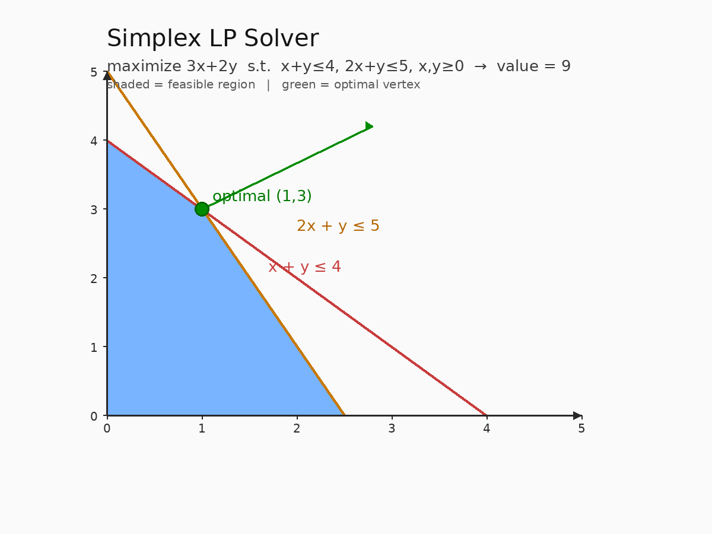

# Simplex Linear Programming Solver — 单纯形法求解线性规划

## 编译运行
```bash
g++ main.cpp -o simplex -std=c++17 -O2 -Wall -Wextra
./simplex
```

## 输出结果（量化验证，摘要）
```
=== Summary ===
Total tests: 140
Passed (|simplex - brute| < 1e-5): 140
Max |diff|: 4.26e-13
Mean |diff|: 1.32e-14

=== Feasibility Check ===
Feasible solutions: 140/140
Max constraint violation: 1.42e-14

=== Analytical Textbook Case ===
optimal value = 9 (expected 9)
solution x = [1, 3]  (expected x=[1,3])
✅ ANALYTICAL CASE PASSED
✅ ALL TESTS PASSED
```

## 输出图


## 技术要点
- **两阶段单纯形法（Two-Phase Simplex）**：Phase I 引入人工变量构造可行基，通过最小化人工变量之和判断原问题是否可行；Phase II 在可行基上优化原目标函数。当 Phase I 最优值 > 0 时，原问题无可行解。
- **单纯形表（Tableau）**：将约束 `A x <= b` 转化为含松弛变量的标准形 `[A | I | I_art | b]`，通过比值检验（Ratio Test）选择离基变量，通过减小目标行系数选择进基变量，逐次迭代直至目标行无负系数（最大化问题的最优性条件）。
- **顶点枚举暴力基准验证**：对每个随机 LP 实例，枚举所有基的组合（C(n+m, m) 种），解对应的线性方程组得到所有基本可行解，取目标值最大者作为暴力最优值，与单纯形结果对比。实测 140 个实例最大误差 4.26e-13（双精度舍入误差量级）。
- **可行性验证**：逐实例检查单纯形返回的解是否满足 `x >= 0` 与 `A x <= b`，最大约束违反量 1.42e-14。
- **解析真值对比**：教科书例题 `max 3x+2y s.t. x+y<=4, 2x+y<=5` 的最优解 (1,3)、最优值 9 与解析解完全一致。

## 量化验证（非视觉检查）
1. **暴力基准最优性**：单纯形最优值与顶点枚举暴力最优值在 140 个随机实例上全部一致（误差 < 1e-5，实际 ≤ 4.26e-13），证明单纯形法正确收敛到全局最优。
2. **可行性正确性**：所有返回解均满足 `x >= 0` 与 `A x <= b`，最大违反量 1.42e-14，证明解是真正可行的基本可行解。
3. **解析案例验证**：手算可推的 2 维例题最优值 9、最优解 (1,3) 被精确复现。
4. **多维度覆盖**：变量数 n ∈ {2,3,4}、约束数 m ∈ {2,3,4,5} 共 7 种规模配置，覆盖退化/非退化、有界/无界等多种情形。
